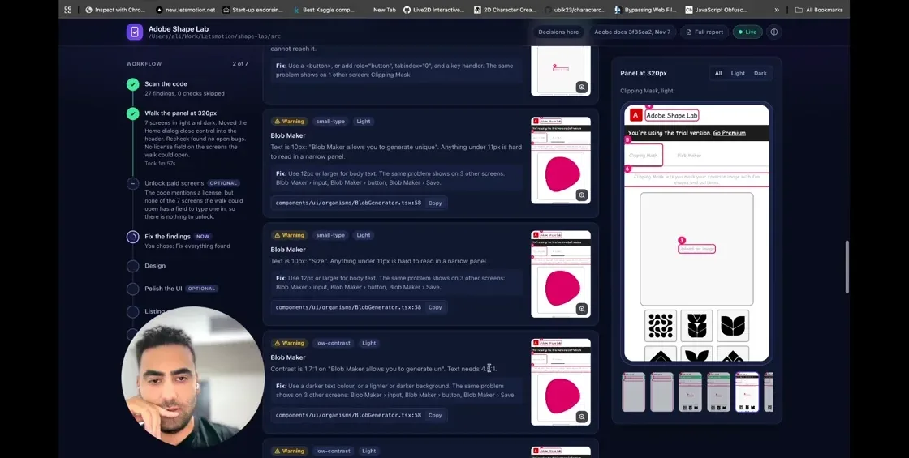

# Express Add-on Reviewer

**Send a stronger add-on to review.** Check your source, upload package, and panel before you submit. Review the findings and prepare your listing in one workflow.

[](https://drive.google.com/file/d/1JKUo__CFvtpCF7M2Kyugx8AeiJLEQply/view?usp=sharing)

[Watch the demo](https://drive.google.com/file/d/1JKUo__CFvtpCF7M2Kyugx8AeiJLEQply/view?usp=sharing) · [Install](#install) · [How it works](#how-it-works)

## How it works

1. **Scan the project.** Check the source and upload package against Adobe guidance and common review patterns.
2. **Walk the panel.** Open reachable screens in light and dark at 320 px and capture what the browser measures.
3. **Review and verify.** Work through the findings and rerun the checks after updates.
4. **Prepare the listing.** Review draft copy and marketplace screenshots before saving them to the project.


## What you get

- **Review an existing add-on.** Start with the project folder and, when available, the ZIP you intend to upload.
- **Work through a rejection.** Turn feedback from a marketplace review into tracked items for the next submission.
- **See the evidence.** Follow progress and open panel captures from the local dashboard.

The browser walk supports preflight checks. Marketplace submission and approval remain with Adobe and the publisher.

## Install

You’ll need Node.js 18 or newer and Git.

```bash
git clone https://github.com/ThisIsMrAli/express-addon-review.git
cd express-addon-review
node install-agents.mjs --global
```

Open a new chat in **Codex**, **Claude Code**, or **Cursor** with your project open. The installer also links supported tools such as Gemini CLI and Windsurf. Keep the checkout on disk so the links continue to work. Omit `--global` to link skills inside the checkout only.

> Use express-addon-review to review the Adobe Express add-on in this folder before marketplace submission.

## Run a review

On this computer, after the install above, open Cursor in any folder and ask it to run Express Add-on Review on the add-on path. You can also type `/express-addon-review`. The agent follows [`.claude/skills/express-addon-review/SKILL.md`](.claude/skills/express-addon-review/SKILL.md). The review stays on this machine: the dashboard is a localhost page, and the panel is built and served here. It does not need an Adobe sign-in.

To run the pieces yourself:

```bash
npm run refresh                                   # download the current Adobe docs once
npm run review -- --input /path/to/addon          # write the report and start a session
npm run dashboard -- start                        # open the local dashboard in Chrome
node .claude/skills/express-addon-review/scripts/audit.mjs
npm run session -- show
npm run dashboard -- stop
npm test
```

Reports are written to `~/.express-addon-review/<slug>/`, not into the add-on and not into this repository.

## What a review covers

**Source.** Checks tied to Adobe’s current docs, plus review patterns taken from marketplace letters. Comments are ignored, markup is read tag by tag, and a project-wide rule looks at the whole project. `index.html` keywords, the meta description, and the document title are not the listing.

**Upload.** A zip in the project root is read in memory: the manifest at its root, the 50 MB limit, no hidden files, the files the manifest names, and whether the zip is older than the source.

**Panel.** The panel is built and served on this computer when nothing is already running, so the walk does not need an Adobe sign-in. It opens at 320px in light and dark and presses every screen it can reach. It does not press Delete, Reset, Buy, or Sign out. Measured bugs, such as a close button at the bottom of a dialog, are fixed and checked again. Warnings wait for one decision.

**Listing.** Text is drafted from the manifest, the package description, and the visible panel. Screenshots are rendered at 1360×800 from one locked template, using only words that are already in the add-on. Both are shown for approval before anything is written into the add-on.

**A person.** Other browsers, a slow network, the publisher website, and test credentials are listed for you. They are not guessed. If the add-on was rejected, paste the letter. Each reason becomes a note, is checked, and is returned as text for the resubmission.

The local dashboard shows the current step, a progress bar, the findings, and the 320px captures. It listens on this computer only. Adobe’s reviewers never see it. If it cannot start, the same decisions continue in chat.

## What it will not do

- Submit the add-on, or claim that Adobe will approve it
- Open Adobe Express or sign in
- Invent listing text, publisher details, or test credentials
- Ask once per finding

## Project site

[Visit the project site](https://thisismrali.github.io/express-addon-review/) for the demo, workflow, and installation guide. GitHub Pages serves the `gh-pages` branch. Run `node scripts/build-pages.mjs` to build the site into `site-dist/` before updating the published branch.

## License

[MIT](LICENSE)
